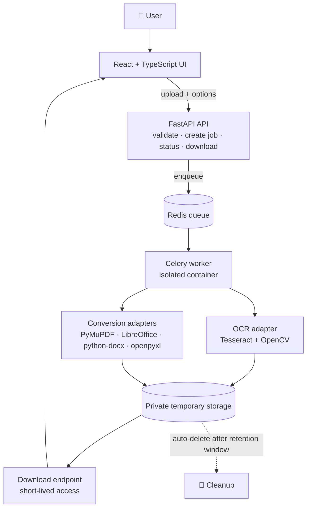

<div align="center">

# 📄 OpenConvert

### Free, privacy-first OCR document converter

Turn scans and images into searchable PDFs and text, and convert Office files to PDF, using a simple web app.


</div>

---

## ✨ What it does

Upload a file, pick an output format, optionally turn on OCR, watch the progress, and download the result. Files are private and deleted automatically.

> **Honest scope:** OpenConvert does **not** promise "any file to any file". It supports a published list of conversions, and each one is covered by automated tests. OCR reads text; it cannot perfectly rebuild layouts, complex tables or handwriting.

## ✅ Supported conversions

| Input | Output | OCR | Status |
|---|---|:---:|---|
| JPG / PNG / TIFF | TXT | ✔ | ✅ Working |
| JPG / PNG / TIFF | Searchable PDF | ✔ | ✅ Working |
| Scanned PDF | Searchable PDF | ✔ | ✅ Working |
| Scanned PDF | TXT | ✔ | ✅ Working |
| Text PDF | TXT | ✘ (native extraction) | ✅ Working |
| DOCX / XLSX / PPTX | PDF | ✘ | 🛠 Planned (LibreOffice) |
| DOCX | TXT | ✘ | ✅ Working |
| XLSX | CSV | ✘ | ✅ Working |
| DOCX / XLSX / PPTX | PDF | ✘ | ✅ Working with LibreOffice |
| PDF | DOCX | best-effort | ✅ Working |
| PDF tables | XLSX | heuristic | 🛠 Planned (review required) |

Unsupported by design: executables, unknown archives, password-protected files, corrupted files, macros.

## 🧱 Architecture



### How a request flows
1. The frontend uploads the file and options.
2. The API checks size, extension, real file type and that the conversion pair is supported.
3. It creates a random, unguessable job ID and stores the file privately.
4. A worker processes the file in an isolated scratch folder (text extraction and/or OCR, then conversion).
5. The frontend polls the job status and downloads the result.
6. All input and output files are deleted automatically.

### Smart processing
- **Text PDF** → extract the native text directly (fast, no OCR).
- **Scanned PDF** → render each page → OCR page by page → optionally rebuild a searchable PDF.
- **Image** → OCR directly.
- **Unsupported pair** → clear `422` response listing the valid output formats.

## 📏 Limits (configurable)

| Limit | Default | Setting |
|---|---|---|
| Max upload size | **20 MB** | `OC_MAX_UPLOAD_BYTES` |
| Max PDF pages | **30** | `OC_MAX_PAGES` |
| Max image size | **60 megapixels** | `OC_MAX_IMAGE_PIXELS` |
| OCR timeout | **60 s per page** | `OC_OCR_TIMEOUT` |
| PDF render quality | **200 DPI** | `OC_RENDER_DPI` |
| File retention | **1 hour** | `OC_RETENTION_SECONDS` |
| OCR languages | `eng` (add more, e.g. `tam`) | `OC_OCR_LANGS` |

## 🔒 Security and privacy

A public converter handles untrusted files, so security is built in from day one.

**Upload protection**
- Extension allowlist plus file-signature (content) checks, never trusting the filename or browser MIME type.
- Limits on bytes, pages, image dimensions, processing time and output size.
- Random server-side filenames. User-supplied paths are never used.
- Macros, scripts and embedded content are never executed. Encrypted or corrupt files are rejected.
- Optional malware scanning (ClamAV) before processing.

**Worker isolation**
- OCR and LibreOffice run in a non-root container with CPU, memory, process and time limits.
- Per-job scratch directory, no outbound network, and the process group is killed on timeout.
- Subprocess arguments are always passed as arrays, never as concatenated strings.

**Privacy**
- Files are deleted automatically (default 1 hour), with a "delete now" action.
- Document text and personal filenames are never logged.
- HTTPS, private storage, short-lived download links and access checks.
- Rate limits and quotas to prevent abuse and runaway costs.
- Errors never expose stack traces, file paths or secrets.

## 🔌 API

| Method | Endpoint | Purpose |
|---|---|---|
| `POST` | `/api/v1/jobs` | Upload a file (`file`, `target_format`, `ocr_enabled`, `ocr_language`) → `202` + `job_id` |
| `GET` | `/api/v1/jobs/{job_id}` | Status: `queued`, `processing`, `completed`, `failed`, `expired`, `cancelled` |
| `GET` | `/api/v1/jobs/{job_id}/download` | Download the result (authorized) |
| `DELETE` | `/api/v1/jobs/{job_id}` | Cancel and clean up |
| `GET` | `/api/v1/capabilities` | Supported formats, OCR languages and limits |

Error codes: `400` malformed · `413` too large · `415` wrong file type · `422` unsupported conversion · `429` rate limited · `500` generic failure.

## 🧰 Tech stack

| Layer | Tools |
|---|---|
| Frontend | React, TypeScript, Vite |
| API | FastAPI, Uvicorn |
| OCR | Tesseract, pytesseract, OpenCV (when needed) |
| PDF | PyMuPDF |
| Office files | LibreOffice headless, python-docx, openpyxl |
| Jobs and data | Redis, Celery, SQLite (prototype) → PostgreSQL (production) |
| Packaging | Docker Compose |

## 📁 Project structure

```
OpenConverter_API/
├── backend/
│   ├── app/
│   │   ├── api/routes/      # job endpoints
│   │   ├── services/        # ocr, pdf, conversion, capabilities
│   │   ├── workers/         # Celery tasks
│   │   ├── storage/         # temporary storage adapter
│   │   ├── security/        # upload validation
│   │   ├── config.py        # limits and settings
│   │   └── cli.py           # command-line converter
│   ├── tests/               # unit and regression tests
│   └── requirements.txt
├── frontend/                # React app
├── docs/                    # architecture, API contract, formats, security, roadmap
└── data/                    # runtime files (git-ignored)
```

## 🚀 Quick start

**Prerequisites:** Python 3.12, [Tesseract](https://github.com/tesseract-ocr/tesseract) (with language data) and LibreOffice.

```bash
git clone https://github.com/aswin147h/OpenConverter_API.git
cd OpenConverter_API/backend

python -m venv .venv && source .venv/bin/activate
pip install -r requirements.txt

pytest                                   # run the tests
python -m app.cli scan.png out.txt       # image  → text
python -m app.cli scan.pdf out.pdf       # scanned PDF → searchable PDF
```

## 🗺 Roadmap

- [x] **Phase 0** – Scope, limits and project structure
- [x] **Phase 1** – Local OCR engine (image/PDF → TXT and searchable PDF) with tests
- [x] **Phase 2** – Office conversions via LibreOffice, CSV/TXT extraction
- [x] **Phase 3** – FastAPI job API (upload, status, download, capabilities)
- [x] **Phase 4** – React drag-and-drop UI with progress
- [ ] **Phase 5** – Docker, queue, rate limits, malware scanning, hardening
- [ ] **Phase 6** – Private beta, then iterate on real usage

## 📚 Docs

Detailed guides live in [`docs/`](docs/): [architecture](docs/architecture.md) · [API contract](docs/api-contract.md) · [supported formats](docs/supported-formats.md) · [security checklist](docs/security.md) · [roadmap](docs/roadmap.md)

---

<div align="center">Built with Python · Tesseract · FastAPI · React</div>
